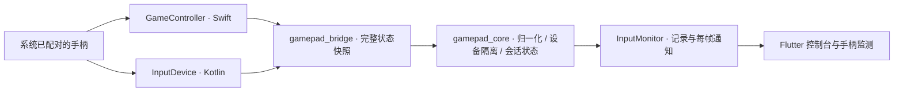
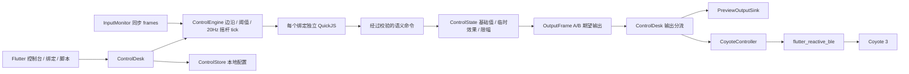

# 架构与兼容策略

## 选择 Flutter + 原生系统手柄 API

Flutter 共享 iOS / Android 的界面、状态处理与控制逻辑，并可用相同代码在 Mac 调试。手柄输入使用系统原生 API：Apple GameController，Android InputDevice / KeyEvent / MotionEvent。无需让 Flutter 自己解析每家手柄的蓝牙 HID 报文。

标准游戏手柄通常由系统蓝牙配对并作为 HID 输入设备出现，不是用通用 BLE 扫描库连接一个自定义 GATT 服务。尤其 iOS 不提供对任意经典蓝牙 HID 的通用底层访问；框架选择无法突破这个系统限制。玩具的 BLE 通道将是另一条链路。

React Native 同样需要原生模块，当前项目没有现有 React 代码可复用；Flutter 的三平台一致绘制与原生桥接更适合这个输入可视化起点。纯 Web / Web Bluetooth 无法覆盖 iOS 上此类原生手柄与玩具连接需求。

## 已实现的依赖方向



| 目录 | 职责 | 不应承担 |
| --- | --- | --- |
| `packages/gamepad_bridge` | 平台设备生命周期、系统事件和标准控制量映射 | 玩具强度、UI 状态、波形规则 |
| `packages/gamepad_core` | 纯 Dart 数据模型、径向死区、单一设备会话和输入状态 | Flutter、蓝牙连接、设备输出 |
| `app/lib/input` | 原生订阅、生命周期、单调时钟超时、最近输入记录 | 厂商蓝牙协议 |
| `app/lib/ui` | 配色、手柄皮肤、坐标与按键显示 | 按键到强度的业务规则 |
| `tools/probe_gamepad.swift` | 独立验证 Apple 原生识别 | 应用运行依赖 |

`gamepad_bridge/darwin` 由 iOS 与 macOS 共享，避免两份 Swift 映射漂移。Dart 使用标准 Pub workspace 管理包，不引入状态管理、服务定位或依赖注入框架。

Android 的 Flutter Activity 必须转发 `dispatchKeyEvent` / `dispatchGenericMotionEvent` 给插件；样板已在 `MainActivity.kt` 完成。暂停时清除插件缓存，插件卸载时取消监听与定时器。此本地插件面向当前单 Flutter engine 应用，不宣称可直接用于多 engine / add-to-app。

## 输入协议 v1

EventChannel：`com.dglab.gamepad/events`。每次输入变化立即发送完整快照；另每 250ms 补发状态，保证持续按住一个按钮时不会因为“无变化事件”被误判为失联。

```json
{
  "version": 1,
  "type": "snapshot",
  "sequence": 1,
  "devices": [{
    "id": "connection-session-id",
    "name": "Xbox Wireless Controller",
    "family": "xbox",
    "transport": "GameController",
    "capabilities": ["south", "leftX", "leftY", "leftTrigger"],
    "values": {"south": 0.0, "leftX": 0.0, "leftY": 0.0, "leftTrigger": 0.0}
  }]
}
```

- `id` 是连接会话身份，不能用厂商名当设备主键；多个同名手柄互不覆盖。重连可能得到新 ID。
- `south/east/west/north` 按系统提供的标准控制位置统一，不把 `A` 写入业务。标签根据 Xbox / PlayStation / Nintendo 显示，未知家族显示 S/E/W/N；个别厂商模式的真实布局仍需实机校准。
- 摇杆 X：左 -1，右 +1。Y：上 -1，下 +1。Apple 的 Y 轴在桥接处反转，Android 使用屏幕坐标方向。
- 扳机与按钮数值为 0..1。数字按钮只提供 0/1 时不会伪造模拟精度。
- `capabilities` 表示系统公开的控制集合。未公开的输入不会作为能力列出；OS 公开不代表它在当前模式下实际有事件。
- 原始值指平台轴范围统一后的值，不是蓝牙字节包。未知控制字段不进入标准状态。无效、NaN 和 Infinity 不向后传播。
- Apple `category`、可用电量，以及 Android VID/PID/轴范围是诊断元数据。Apple 不保证公开原始 VID/PID，也不在此处猜测连接是蓝牙还是 USB。

## 归一化与会话

圆形死区在中心抑制漂移，超出死区后连续映射到单位圆；斜向输出长度不超过 1，方向不变。原始输入仍用于诊断。当前没有添加平滑动画或输入滤波延迟。

首次连接、切换手柄、恢复前台和恢复断流后，先等中立状态再提供有效输入。后台或暂停会清零有效状态。1.5 秒没有原生快照则标为中断并清零；这检测的是桥接流，不是对蓝牙物理链路的独立硬件心跳。硬件断开依赖操作系统通知。

当前设备断开时不自动选另一只手柄；用户需重新选择。设置死区不能让超时前的旧输入恢复。多个设备各自保存状态，只有选定设备进入有效输出。

所有输入事件都会先同步处理并记录，再按 Flutter 帧节奏通知 UI。UI 绘制可以合并同一帧内的多次输入；未来业务映射必须在输入处理链路订阅每个事件，不能从界面重绘次数推断按钮边沿。

## 外观不等于驱动

照片中的手柄是飞智冰原狼 2，当前模拟 Xbox 身份。`GamepadAppearance` 只控制绘图，默认是用户给出的冰原狼外观，另有通用布局。不会因为所有设备都叫 Xbox 就认定它们都是飞智。猫爪帽、壳体装饰和物理功能键的绘制不代表系统公开了这些控件的独立输入。

M1/M2 在某些模式由固件映射到普通按键，此时只能收到映射结果。背键、宏键、Home / Share 可能被固件或系统占用。必须测试，不能承诺全部独立读取。

## 扩展新手柄

1. 优先确认系统是否识别，检查现有标准桥接是否已覆盖，无需为每个品牌新建驱动。
2. 保存一次输入记录，记录平台、系统版本、连接模式、轴范围和实按对应关系。
3. 只有证实某款固件违反标准映射时，才增加限定到明确设备身份与模式的修正。不能凭显示名称给全部 Xbox 设备套修正。
4. Android 已兼容常见右摇杆 Z/RZ 或 RX/RY，以及 LTRIGGER/RTRIGGER 或 BRAKE/GAS。非标准组合、组合式单轴扳机和键盘模拟模式需另加经验证的 profile；不能随意把 Z 同时当扳机与摇杆。
5. 系统不支持的厂商私有 BLE 手柄，需要其公开协议再添加独立适配器；仍输出同样的标准状态。如果 iOS 不允许访问该模式，应指导用户换兼容模式，而不是承诺软件能突破限制。

## 控制与脚本边界



- `app/lib/control/models.dart`：双通道模型、波形元数据、绑定/脚本声明、输出接口。
- `control_state.dart`：基础强度、通道控制参数与临时效果分层；命令批次原子提交；输出限制到 0–200。
- `control_engine.dart`：同步处理每次输入；按钮边沿、扳机阈值、摇杆 tick、触点输入仲裁、错误隔离与复位。
- `output_waveform_trace.dart`：作为独立 `OutputSink` 把控制层输出帧推进为时间戳脉冲轨迹，不依赖 BLE 连接。
- `app/lib/scripting/action_runtime.dart`：脚本注册、配置 schema、只读上下文、受限 JS 执行。
- `app/assets/actions`：10 个内置操作的真实 JS 源码；用户脚本沿用相同执行链。
- `control_desk.dart`：连接 UI、会话、引擎与存储；不包含设备协议。
- `app/lib/ui/control`：A/B 控制台、通道控制参数、自动生成的绑定表单、脚本导入/源码编辑。原有手柄监测页保留。
- `app/lib/coyote`：Coyote 3 BLE 扫描／连接、通知解析、10Hz 输出循环和 20 字节控制包编码。
- `app/lib/control/touch_control.dart`：二维触控映射、波形频率压缩与平衡参数转换，不依赖 Flutter。
- `app/lib/ui/control/touch_panel.dart`：单通道触控弹窗、设置、调试读数与粒子轨迹；只把归一化触点交给 `ControlDesk`。

按钮和触发器在同步 frames 流中处理，避免漏掉同一帧内的按下/松开。摇杆使用 20Hz 的有界 dt，不把后台积累时间当作大幅增量；触控面板打开时，同一个摇杆脚本把向量映射成经过校验的 `touchPoint` 命令。`toggleTouchPanel` 命令只产生一次性 UI 请求，由 `ControlHome` 消费并复用现有弹窗生命周期。屏幕手指拥有触点优先权，设置页隐藏触控区域时禁止重新激活。UI 读取同一 ControlState，显示基础强度、临时加成、最终强度、启停、选中通道、波形光标与触控落点。IMU 不参与业务控制。

停用通道只把输出归零，基础强度保留。全部停止、进入编辑、输入失联、后台和脚本故障停止两路并清除临时效果。恢复不会自动启用通道。按住型动作锁定激活时通道；所有百分比增减基于基础值计算。

`OutputSink` 分流到本地预览、`OutputWaveformTrace` 和 `CoyoteController`。波形轨迹 sink 即使未连接郊狼也会按 100ms 节奏消费控制层的 `OutputFrame`，因此界面动画不依赖设备状态；Coyote 适配器只在下游独立负责连接和蓝牙发送，未连接时只保存最新帧。连接后，Coyote 适配器扫描名称前缀 `47` 的设备，使用 `180C/150A/150B` 服务，把 `OutputFrame` 转换为每 100ms 一包的 A/B 强度与两路原始脉冲帧。Android 连接后请求 64 字节 MTU，满足 Coyote 3 的 20 字节控制包。上游控制数据是期望值；界面单独显示设备通过 `B1` 通知回报的强度。触控模式的二维映射与安全归零由 `ControlState` 负责，界面不直接写蓝牙。停用通道、全部停止、输入失联、后台、编辑和设备断开都会停止本地下发循环；主动停止或断开时写入空白脉冲与零强度，结束触控时只归零被接管的通道。

详细注册函数、事件、字段、命令、冲突规则、执行上限和示例见 [脚本 API](script-api.md)。

## 验证范围

输入层保留归一化、设备隔离、首次回中、断流和生命周期测试。控制层使用真正的 QuickJS 执行全部内置脚本，验证百分比、负增量、多绑定叠加、通道锁定、阈值滞回、波形选择、摇杆加速、故障复位与脚本资源限制。界面覆盖手机窄屏、桌面与文字缩放。

Apple 平台已做 macOS 和 arm64 iOS 模拟器构建。Android 原生源代码仍待具备 SDK/JDK 的环境编译和真机验证；iOS 手柄、脚本导入与 Coyote BLE 需真机验证。既有手柄监测由用户实按确认；Coyote 包编码有自动测试，但实体输出仍需安全实机验收。
